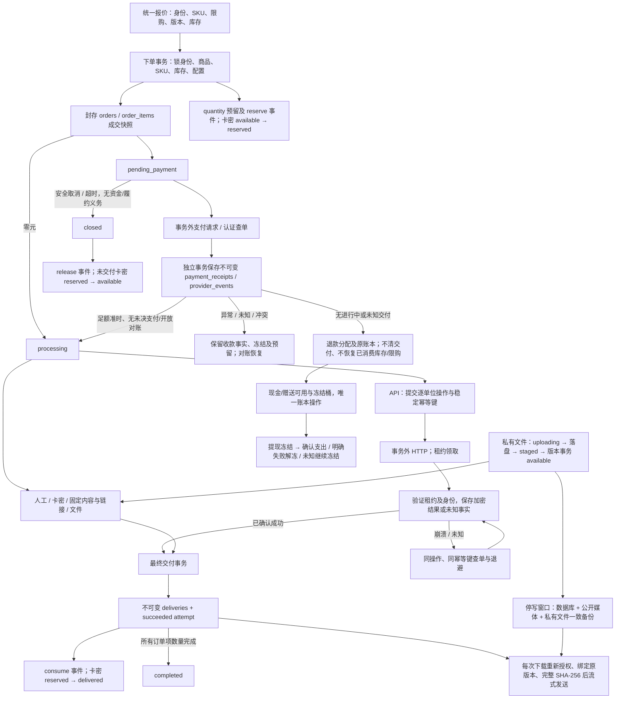

# 阶段⑤-5：数字履约全局验收

基线：`f3d145f15f7c472bf2d29b05ea865806f222e53a`。本阶段不部署生产；受控供应商不等于真实商业供应商验收。本报告记录跨模块事务关系、实际缺陷修复、可重复测试和实测证据。

## 状态与事务关系



锁顺序：下单为顾客/游客 → 幂等 → 策略 → 按 UUID 排序商品 → SKU → 数量库存 → 履约配置；交付为订单 → 订单项 → 商品 → SKU → 数量库存 → 配置 → 供应商操作 → 尝试。供应商 HTTP 和文件完整读取不占用这些事务锁。钱包路径先顾客，再订单/钱包、支付尝试；提现为顾客 → 钱包 → 提现 → 打款尝试。订单关闭持订单锁与订单 advisory lock，不反向更新支付尝试。实际并发测试必须观察数据库等待或 IPC/HTTP 屏障，不用固定 sleep 推测时序。

核心约束：`fulfilled_quantity` 是成功尝试的数量和，`fulfillment_reserved_quantity` 是 processing/unknown 尝试的数量和；成功交付每单位恰好一条。数量库存由不可变调整及 reserve/release/consume 事件核算；unlimited 不产生数量预留。付款回执不与失败履约共同回滚。所有版本、回执、账本、库存事件、交付及审计永久保留。

## 五类业务能力的状态闭环

| 业务能力 / method | 成功事实 | 库存与恢复 |
| --- | --- | --- |
| 人工 `manual` | 管理员逐件正文、操作幂等、活动尝试及逐单位保护 | quantity消费，unlimited不建数量事件；提交后响应丢失重放返回原结果 |
| 卡密池 `code_pool` | 下单绑定reserved卡密，成功交付的独立加密行 | available → reserved → delivered；安全取消只释放未用卡密；回滚不遗留预留或扣减 |
| 固定内容/链接 `fixed_content`、`link` | 成交绑定不可变版本，按单位保存加密历史 | 新版本/方式切换不替换旧订单；历史密钥缺失失败并退避，恢复后继续 |
| 私有文件 `file` | 成交/交付绑定不可变文件版本和摘要 | 文件落盘与数据库分步推进；每次下载重新授权并校验完整SHA-256 |
| 外部接口 `api` | 一个单位一个稳定操作；加密确认结果先持久化再最终交付 | 同ID/幂等键查单；已知ID丢失转人工核对；只有明确拒绝才允许单件新操作 |

混合订单分别覆盖quantity和unlimited（卡密始终quantity）。六种method各买2件，自动项完成后整单仍为processing，人工项先交1件仍不完成；最后1件完成后才completed。两个API实例/worker不重复交付。全额退款后12条交付行不变，文件仍可按原授权下载，卡密不回可售池。已有订单不依赖当前商品发布状态、当前履约方法或当前供应商启用状态；已有版本及外键保留。复制、归档、SKU退役、限购、取消和超时边界由原集成及浏览器用例交叉回归。

新交付统一要求processing、零元或足额准时回执、无未决支付/开放对账、无活动退款/退款预留/已退款事实。退款与交付在订单行锁上串行：进行中或未知尝试阻止新退款申请、审核、分配及钱包入账；退款先获得资格则阻止后续新交付。已记录的原路退款转账凭证是资金事实，仍可保存，不能因历史交付冲突丢弃实际转账证据。已交付内容的授权读取与新履约资格分开，因此退款不删除或隐藏既有交付。

## 实际发现与修复

全部修改沿现有模块完成，只有一项前向迁移，没有重写冻结迁移、资金账本或订单状态机。

| 问题与根因 | 影响 | 修复与证据 |
| --- | --- | --- |
| 退款仅检查支付/对账，未检查未决交付；worker只看原收款总额 | 供应商已执行但响应未到可申请退款；全退后仍会新发货 | 订单锁下双向保护；新增SQL触发器及资格检查；两个反例先复现201退款/额外一次供应商请求，再通过409、零新请求和安全关闭回归 |
| 负查单要求不存在的商品/金额快照 | 租约提交、请求前崩溃后永久无法恢复 | 明确绑定原查询键的最小not_found信封；真实SIGKILL后负查单、同键创建、最终交付 |
| 去重查询与插入未跨SKU/活动密钥串行 | 两实例同时通过历史查询，索引因key ID不同允许重复卡密 | 供应商连接+商品级事务advisory lock；移除锁的确定性屏障反例产生2条，修复后1条成功、另1条manual_review |
| 去重忽略缺失的历史指纹密钥 | 轮换配置漏旧键时不能比较历史，却继续请求发货 | 新请求前检查历史键，结果最终确认时再次在去重锁内检查；缺失时保留收款并退避，恢复键后识别重复结果 |
| 全局前20候选包含始终受支付保护的API项 | 20个旧开放对账订单饿死新订单 | 在LIMIT前过滤支付、对账和退款保护；20个受保护订单之后的新订单完成，受保护订单零新操作 |
| API重试只检查最近失败，重试授权未按单位消费 | 同一项多个明确拒绝时，较早单位的授权被较新失败挡住；重放旧请求可能重复授权 | 按单位选择已授权失败，在替换事务内消费一次；重复排队仅1条审计，已消费操作409；旧候选屏障证明不能擅自重试另一失败单位 |
| 网络扫描与本地扫描串行；一次预领20租约后逐个HTTP | 慢供应商延迟其他方式，后面的租约可能尚未执行即过期 | 同worker内独立轮询，4个供应商请求并发领取/执行；旧调度反例在HTTP屏障释放前不能交付，修复后本地项先完成 |
| SQL未统一约束单位、活动尝试及API身份；锁等待前的尝试状态可能过期 | API单位可改写；人工可跨尝试重复单位、向已结束尝试追加 | 数据库校验单位范围、跨尝试重复、活动状态及API结果/单位/版本；订单/订单项锁后重新读取并锁定尝试；真实PG锁等待反例及直接SQL违规回归 |
| 人工成功触发器缺少自动方式同等的支付/对账复验 | 先准备正文，再开对账后可直接SQL成功 | 所有方式成功转换统一复验支付、对账、退款；收款保持，违规成功被23514拒绝 |
| 全局错误日志序列化PostgreSQL error.detail | 失败行含私有交付明文，进入日志 | 只记录请求关联、错误名/安全代码/约束名；真实PG检查约束异常先复现明文泄露，再断言日志无正文且保留23514与约束名 |
| DNS等待不受HTTP计时器约束；漏拒3fff::/20 | DNS可无限等待；文档地址误判公网 | DNS纳入8秒总预算，逐请求重新解析且固定已校验地址；拒绝文档前缀及IPv4/IPv6内部/映射地址；真实隔离TLS拒绝自签名证书 |

IPv6文档前缀依据[IANA特殊用途地址注册表](https://www.iana.org/assignments/iana-ipv6-special-registry/)核实。请求不跟随重定向，不访问或执行供应商返回的链接。身份、幂等键、操作ID、商品、金额、数量和币种错配均不能成功交付。

## 库存与交付账实核对

[只读SQL](../scripts/reconcile-digital-fulfillment.sql)可重复执行，返回的每一行都是差异。检查成功/活动尝试与订单项投影、成功交付数和单位唯一性、reserve/consume/release、全SKU库存汇总、不可变调整/补货/撤回/消费流水及卡密available/reserved/delivered数量。它假定受支持API创建数量库存时从0起步；导入的历史期初库存必须有原始调整证据，否则报告无法解释的库存，不自动补流水或修改汇总。

```sql
BEGIN ISOLATION LEVEL REPEATABLE READ READ ONLY;
-- 可选：只核对指定SKU；不设置则检查全部。
-- SET LOCAL aikayun.reconcile_skus = '<uuid>,<uuid>';
\i scripts/reconcile-digital-fulfillment.sql
COMMIT;
```

混合订单在预留、部分交付、全部交付和退款后均零差异。固定内容SKU消费库存后，通过真实调整流水清空余量，再切换并导入卡密，历史订单仍读取原固定版本；核对卡密消费时按成交method快照统计，避免把切换前其他方法的消费误算为已发卡密。实际Compose订单含6种method、12个单位，完整恢复后全库核对零差异。数量库存通过受保护的增加流水及卡密导入建立，未直接改汇总余额/库存掩盖差异。原回归继续覆盖取消释放、超时释放、最后一张卡并发、撤回与下单竞争、商品复制/归档/退役、库存调整和退款后限购不恢复。

## 真实SIGKILL及恢复边界

测试夹具在独立进程包装真实pg驱动，IPC明确通知边界后才发送SIGKILL，并断言退出信号。生产代码没有故障注入开关。重建真实API进程、重新建立数据库连接并运行原worker；不以抛异常、模拟断线或普通重启代替强杀。

| 边界 | 崩溃后事实及恢复证明 |
| --- | --- |
| 外部操作提交 / 租约提交后、HTTP前 | 供应商执行0次；过期租约按原键查单，明确不存在后仅原键创建；最终执行1次 |
| 供应商已执行，响应被HTTP屏障阻挡 | 供应商执行1次；强杀后按原幂等键查询，不再次创建 |
| 响应已解析、结果数据库更新前 | 操作仍in_flight；重建查单保留原操作，最终一次交付 |
| 成功加密结果事务已提交，最终交付前 | succeeded_pending_finalize；重建只做最终交付，不重新执行供应商 |
| 最终API交付/库存事务提交后 | 重建不重复交付、消费或释放；另有真实人工HTTP路径提交后强杀，连接丢失后原操作重放repeated=true |
| 文件发布并fsync后、数据库staged更新前 | uploading行及真实对象可核对，不能保存版本或销售；模拟时钟跨越24小时TTL后只回收该未引用对象 |
| 卡密预留事务 / 交付事务未提交 | 强杀使真实PG连接断开，整体回滚；重建逐件完成，剩1张available、2张delivered，零重复库存事件 |
| 固定内容/历史密文缺键 | 明确失败并退避，保留已确认付款；补回原键后继续原版本；不生成空内容成功 |

所有API崩溃用例比较原收款回执完整行，原操作UUID/幂等键不变，每单位最终仅1条交付和1次consume。未知结果、429、500、中断及真实8秒HTTP超时不作为拒绝；查询仍使用原操作。供应商成功后结果加密密钥临时消失，也保留unknown，恢复密钥后按原键查单。供应商已知ID后来查不到时保留身份并转人工核对。

过期租约的旧worker晚到测试在新worker提交后保存完整操作行及事件数量，再释放旧HTTP响应：两者均不变。SQL终态与已保存结果不可变保护继续存在；管理员未知重试被409拒绝，查单/明确拒绝重试有CSRF、同源、管理员身份和只追加审计。游客、其他顾客和无会话读取继续严格隔离。

明确拒绝后的重试按单位授权。管理员重复点击在排队期间返回同一排队状态，不再追加审计；worker提交替换操作时清空该失败尝试的retry_after，之后旧操作重试返回409。即使另一个worker已领取旧候选，也必须在订单事务内重新检查该单位授权，不能将候选资格当作其他失败单位的新操作许可。

## 容器、备份与持久化

`node scripts/verify-digital-recovery.mjs`自行创建独立test项目、随机回环端口、_test数据库、项目专属卷及合成密钥，完成后台配置、实际HTTP付款夹具与六method混合订单。分别SIGKILL并替换API和PostgreSQL容器后，检查历史表计数/内容摘要、全部授权明文视图、文件下载SHA-256和库存。随后调用实际备份脚本，在引用文件丢失且下载410后，用实际恢复脚本恢复数据库+公开媒体+私有文件。

执行结果：1张真实受控支付回执、12个交付单位；所有method历史可读，全库账实差异0，私有文件检查verifiedObjects=1且needsAttention=false。恢复文件SHA-256为 `637e2b531ef331d6b8c861eec9864524e066c7ab3a4315ecdd5215c56580b422`。自签名TLS在另一无外网网络命名空间被真实Node TLS拒绝，HTTP处理器收到0个请求。脚本finally只清理自己项目、卷、镜像和临时文件，也已加入GitHub Actions。

## 文件性能与故障隔离

Apple Silicon本机、Node24、真实文件系统及回环HTTP，100MiB文本文件；客户端和API在不同进程。下表为本轮热缓存测量，全部下载字节都在客户端核对SHA-256；每个Range仍先读取并校验完整100MiB，不能把返回1MiB误认为只读了1MiB磁盘。该结果不代表冷盘、跨公网或生产容量承诺。

| 场景 | 总耗时ms | TTFB范围ms | 返回吞吐MiB/s | API CPU ms | API进程峰值RSS MiB |
| --- | ---: | ---: | ---: | ---: | ---: |
| 1个完整下载 | 110 | 41 | 907.8 | 161 | 386.0 |
| 4个并发完整下载 | 375 | 74–139 | 1067.0 | 626 | 389.8 |
| 4个并发1MiB Range | 136 | 122–136 | 29.4 | 146 | 389.8 |
| 4完整+4 Range | 499 | 201–268 | 809.0 | 767 | 390.2 |

RSS包含Node/tsx、应用及此前100MiB上传的进程基线，是进程累计峰值，不是每次下载分配量；并发从1升至8时记录的峰值由386.0增至390.2MiB。按现有完整校验加响应读取路径核算，四种场景分别读取200、800、404和1204MiB文件数据；热缓存下不能把这种逻辑读取吞吐当作物理磁盘吞吐或冷盘容量。当前测量未显示需要牺牲完整校验的瓶颈，因此下载算法、完整性校验和授权保持原实现。HEAD、单Range、重复下载、缺失/同长度损坏、符号链接/路径及跨身份访问继续回归。

100个待处理固定内容订单、两个worker在5轮、445ms内清空；该压力路径新增死锁0、残留idle-in-transaction为0。真实HTTP屏障保持供应商未返回时，本地固定内容先完成；未知操作退避，不进行无限快速轮询。没有引入Redis、队列或监控常驻服务。

## 回归、冻结及未验证边界

2026-10-23本地完整`pnpm verify`退出0：金额单测10项、13个API测试文件共277项、完整Chromium共54项（主E2E48、备用品牌1、SSR3、开发预览1、生产运行时品牌1）全部通过。最终核对SQL增加配置切换场景后，13个API文件277项再次全部通过。Lint无错误，保留52条现有Vue格式警告；字体元数据网络重试警告未造成构建或浏览器失败。独立Compose强杀/替换、实际备份恢复及无外网TLS脚本退出0，已纳入CI。

最终main提交的GitHub Actions仍须实际启动runner、执行各步骤并以completed/success结束；最终SHA及CI链接在交付回复中记录。验收命令：

```sh
TEST_DATABASE_URL='<专用_test连接>' pnpm verify
node scripts/verify-digital-recovery.mjs
```

本机本阶段创建的两个隔离测试数据库、专属容器/卷/镜像、临时脚本/日志/密钥及浏览器测试输出已清理；恢复脚本创建的各独立项目也均在finally清理。原有开发数据库、API、Web和Caddy持续运行，未重建或清空其数据。原始临时截图与日志按要求不入库，永久证据为本报告、可重放测试及最终Actions日志。

主要证据入口：`apps/api/test/external-api-delivery.integration.test.ts`（真实付款、SIGKILL、租约、跨键、退款与混单）；`private-file-delivery.integration.test.ts`（真实文件、权限、损坏、上传强杀及100MiB基准）；`http-json-v1.test.ts`（地址与DNS）；`orders.integration.test.ts`、`payments.integration.test.ts`、`commerce-foundation.integration.test.ts`、`withdrawals.integration.test.ts`（阶段④及⑤历史交叉回归）；`apps/web/test/e2e`（完整Chromium后台、结算、交付、订单和下载）。审查追溯到冻结交易基础与各前向迁移，并通过真实PG的pg_trigger/pg_proc核对最终生效函数，避免把旧迁移中已替换的函数当成运行规则。

以下仍为NOT_VERIFIED：真实商业供应商的执行、计费、业务完成含义、幂等承诺、查询一致性、旧凭据撤销后的历史查单，以及真实商户收款/线下退款/打款。受控HTTP和隔离TLS只证明商城本身的契约、安全与恢复，不代表已接入商业供应商。数据及历史密文仍要求部署方保留原加密密钥；私有卷和备份的静态加密仍由部署平台提供。未知/矛盾外部结果保持人工核对，不提供伪造成功入口。

未部署生产，未进入后续阶段。阶段⑤的冻结以包含本报告的最终main提交及其实际执行成功的CI为准；最终SHA与CI链接随交付回复提供。
