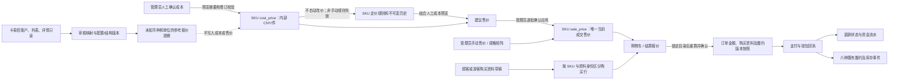

# ⑥-3C：定价、商品与交易全局一致性验收

## 范围和固定基线

本轮以 `7132fa424518bbef4becdb96533e0baa5b945011` 为固定基线；开始时本地 `HEAD`、`origin/main`、GitHub `main` 一致，工作区干净。复核⑥-2A、⑥-2B、⑥-2C-1、⑥-2C-2、⑥-3A、⑥-3B及既有订单、支付、退款和数字履约资料。使用隔离 PostgreSQL、Fastify、Chromium 和本机供应商夹具，没有连接真实采购接口或修改业务数据库、既有私有卷。

本轮沿用既有商品、定价、购买行、交易及履约模型；不增加另一套售价、成本或交易账本。金额计算以 `@aikayun/money` 的 Decimal.js 实现为准。

## 数据流与权威来源

| 数据 | 权威来源和用途 | 不能推导的结论 |
| --- | --- | --- |
| 当前成交售价 | `product_variants.sale_price`，CNY，最多两位小数；公开目录和新报价从此读取 | 规则建议或上游报价不是第二份成交售价 |
| 内部单位成本 | `product_variants.cost_price`，管理员人工确认的 CNY/件，最多五位小数，允许缺失和明确的零 | 成本变更不代表供应商扣费，也不自动改变售价 |
| 上游参考报价 | 卡易信 V3 `quote.amount` 原始十进制观察；币种 `null`、单位未验证、实际扣费未验证 | 不能当作 CNY 成本、成交价或采购资格 |
| SKU 身份及状态 | 商品和 SKU UUID、规格值身份、商品/SKU 修订、库存修订与生命周期 | 临时停用可恢复；永久退役身份不能重新销售 |
| 规则建议和历史 | SKU 当前规则、`pricing_rule_revision`、`product_variant_pricing_rule_versions` 及管理审计 | 保存/恢复规则不会修改售价；历史版本不能被覆盖 |
| 购买行 | 身份绑定的草稿、冻结模板版本、规范化内容身份与行 ID/修订 | 相同 SKU 的不同资料不能合并；同内容可合并 |
| 已成交交易 | `orders`、`order_items`、封存的 `order_item_purchase_snapshots` 和私有附件归档；支付、退款及履约各自的不可变事实 | 后来的目录、成本、规则或映射变化不能改写既有订单 |

同来源比较要求连接、配置版本、上游商品/SKU 身份、规格组合、报价范围和结构指纹一致；否则不显示原始数值差。审核映射仅表示结构映射经过人工审核，不启用采购或外部履约。公开目录不读取内部成本、利润参数、供应商凭据或顾客资料；顾客结算也不依赖实时上游读取。

规则配置实际改变时递增规则修订，非手动规则进入 `pending`，确认应用后为 `applied`；直接改售价或成本使非手动规则进入 `stale`，仅改划线价且仍满足约束不会把已应用规则误标为失效。恢复历史创建新版本。`manual` 无建议售价。规则应用与成本确认分别校验商品/SKU 修订、规则版本及输入摘要；多 SKU 任一校验失败整批回滚。`ROUND_HALF_UP` 只在建议售价落到分时执行，缺成本不等于零，溢出和划线价冲突不允许应用。

规格矩阵保留已有 SKU 身份及其成本、规则；新 SKU 从空成本、`manual`、规则修订 0 开始。商品复制保留售价及划线价，但新 SKU 使用新身份、空成本和手动规则，不复制规则身份/历史；成本必须重新人工确认。安全删除原商品后不可变规则版本仍以原 UUID 留存在数据库历史中，管理员可按原商品和 SKU 身份读取；未知身份仍返回 404。

## 报价、订单和状态边界

报价摘要绑定顾客可见的当前单价、资格、库存、限购、履约版本及购买行信息；V2 使用内容身份和冻结模板绑定，不把填写明文序列化进摘要。仅人工成本、规则参数或划线价变化而报价可见事实不变时，原报价无需因为内部变化重新确认。售价上涨或下降、库存/资格/履约或资料发生相关变化时，尚未下单的旧报价须重新确认；成交事务在锁内重算，不能用旧价格创建新订单。

已创建但未付款的订单保持成交价和原有付款资格；之后调价不重算它。付款结果未知时沿用原支付尝试、回执及对账保护，不按新目录价格重建订单。已付款及已退款订单继续以原订单、收款和退款事实为准；安全关闭未付款订单的库存和额度释放遵守既有状态机。相同主体和幂等键、相同规范化请求先查回原订单，后续目录或映射变化不能再次预留库存或计入限购；不同主体或请求不会借用该结果。免费和付费商品混单仍按各行成交价汇总，不产生虚构钱包流水。

## 锁序、约束与修订

- 管理员目录写入先锁商品并校验商品修订，再按 SKU ID 排序锁相关 SKU；涉及库存时继续锁数量库存。规则和成本批量写入在同一事务中验证全部输入。
- 下单先验证并锁定顾客或游客主体，再取得主体/幂等键 advisory lock 并检查已有订单；之后锁店铺策略、按 UUID 排序的商品 `FOR SHARE`、SKU `FOR UPDATE`、数量库存、履约配置，重算报价并封存订单。购买行另校验草稿、模板、归档对象与身份；文件复制不依赖长期持有目录锁。
- 供应商映射路径按商品 → SKU → 供应商连接 → 冻结模板 → 映射头锁定，并校验连接配置及结构修订。外部只读请求不作为顾客结算事务的前提。
- 库存预留/释放/消费由订单事件与数据库触发器维护；规则状态、商品/SKU 修订、购买行绑定、快照封存和历史不可变性由相应约束及触发器保护。应用入口先锁商品很重要：SKU 更新触发器也会触及父商品修订，不能把随意反向 SQL 写入当作受支持的锁序。
- 成本预览摘要、管理员权限和确认操作由应用 API 验证；数据库约束校验金额、状态及不可变历史，但不证明具有直接写权限的数据库操作者经过页面确认。不能把数据库数值约束描述为对特权 SQL 的管理员授权证明。
- PostgreSQL `NUMERIC(18,5)` 会在约束检查前按列类型转换输入；隔离库实测 `1.123456` 转为 `1.12346`，`0.000001` 转为 `0.00000`。数据库约束约束的是转换后的存储值，不能宣称任意特权 SQL 的超精度原始文本都会被拒绝；应用 API 对成本五位、售价两位的输入先做严格校验。
- 支付、钱包、退款及交付沿用各自订单/顾客/钱包及操作幂等锁序；可重试的 SQL 冲突不等于已确认外部业务失败。参见 [订单与人工数字交付](orders-and-fulfillment.md) 和 [数字履约全局验收](digital-fulfillment-acceptance.md)。

在隔离 PostgreSQL 18 的最终迁移状态查询 `pg_trigger` / `pg_proc`，确认实际生效的 SKU 定价状态、商品锁和修订、规则历史不可变、购物车绑定/修订、订单金额/库存、购买限购、快照封存以及供应商报价历史保护触发器；没有修改或关闭这些约束来通过本轮并发测试。

本轮定向并发回归先持有真实 SKU 行锁，使用 `pg_stat_activity` 与 `pg_blocking_pids` 观察第一笔请求持有商品锁并等待 SKU、第二笔请求等待第一笔商品锁，之后释放门闩。覆盖成本确认对规则修改、售价应用对 SKU 停用，以及下单与调价的两种先后顺序；不以固定 sleep 推断并发顺序。结果分别验证过期修订拒绝、无部分写入、旧报价冲突或已先成交订单的原价保留，以及库存预留和限购只计一次。

## 本轮发现和修复

**商品复制绕过新 SKU 的成本确认。** 固定基线上，真实 PostgreSQL 复制测试先对源 SKU 人工确认 `12.34567` 并配置规则，再复制商品。数据库查询显示新商品的新 SKU 直接获得 `cost_price = 12.34567`，规则却重置为 `manual`、修订 0；管理员没有为新 SKU 预览和确认成本。将新 SKU 成本应为空的断言加入现有验收后，基线真实失败。根因是复制路径直接赋值 `sourceVariant.cost_price`，沿用了早于人工成本确认流程的复制逻辑。

修复只改变未来商品复制：新 SKU 成本置空，已有 SKU、售价、划线价和原规则历史不被改写；后台价格区明确提示复制后需重新确认成本。原 SKU 仍按既有规则保留成本，新 SKU 若需要成本须走⑥-3B预览与确认。测试同时覆盖普通复制和源商品全部 SKU 已退役时的兜底复制，避免把退役 SKU 的历史成本赋给新身份。没有追溯清空既有业务数据。

由于本轮不读取或修改现有业务数据库，无法断言历史复制产生的成本已逐 SKU 重新确认。上述人工确认保证适用于修复后的应用写入路径；存量复制数据是否存在及其成本是否仍有效，需要在另行授权的数据核查中确认。

**安全删除后规则历史无法通过接口读取。** 真实 PostgreSQL 验证源商品安全删除后，`product_variant_pricing_rule_versions` 原始行未改变，但管理员按原商品/SKU 请求规则历史时得到 `404 SKU_NOT_FOUND`。根因是读取接口先要求当前 SKU 存在，即使不依赖目录外键的不可变历史仍在也不读取。修复后先按完整原商品/SKU 身份查历史；存在历史即可由管理员读取，不存在历史时仍验证 SKU 存在，未知身份仍为 404。未授权请求仍为 401；恢复规则和修改 SKU 仍要求当前 SKU 存在。

**后台组件各自缓存 CSRF 导致后续操作失败。** 真实 Chromium 先由商品页确认成本，再由定价规则组件保存并应用规则，随后点击商品复制；应用规则返回 200，复制返回真实 403。请求跟踪显示前者的 CSRF 请求头与 Cookie 一致，而复制请求中的两者不一致。根因是每个 `useAdminApi` 实例各自缓存令牌，另一个组件或浏览器上下文刷新共用 Cookie 后，旧实例继续使用旧请求头。

修复后后台写入和上传取得当前浏览器 CSRF Cookie；同一 Nuxt 应用首次获取令牌时共享进行中的请求，避免组件同时生成不同令牌。请求途中 Cookie 再次变化时，服务端明确以 `CSRF_INVALID` 在业务处理前拒绝，页面显示失败并由管理员重新发起，不自动重放写操作。定向浏览器流程在应用规则后轮换真实 Cookie，并在复制请求捕获请求头后再次轮换：真实 API 先返回 `403 CSRF_INVALID`，管理员重新点击后返回 201，实际请求两次且只创建一份复制商品；随后核对新旧 SKU 成本与售价。

**成本确认结果未知时的后台反馈。** 固定基线上，真实 Chromium 将成本确认请求交给 Fastify，等待真实数据库提交并收到 HTTP 200 后，在浏览器响应边界中断连接。页面显示“服务器暂时无法处理此请求，请稍后重试”，没有区分结果未知。随后直接查询隔离 PostgreSQL：售价 `15.00000` 未变、成本已为 `10.12345`，且只有一条价格审计。这证明普通失败提示不能代表事务回滚。

根因是管理 API 客户端把无响应和 5xx 归一化为普通错误，而成本确认页面直接展示该消息。修复后，成本确认遇到无响应或 5xx 时提示结果未知，保留本地输入，读取服务器商品和价格并展示当前成本；管理员核对前暂停本页成本/售价提交及分页。读取期间再次发生商品修订变化时要求重新读取；请求按商品、页码和代际归属，迟到结果不能接管切换后的页面。管理员可以保留输入或采用服务器版本。确定的 409 冲突继续显示冲突，不伪装成结果未知；相同旧确认请求重试被修订校验拒绝，不生成第二条审计。

**浏览器测试导航同步。** 定向订单浏览器测试曾在注册后仅等到 URL 变为 `/account` 就立刻发起下一次页面导航，Chromium 返回 `ERR_ABORTED`；跟踪显示下一跳发生在 URL 检查后约 3 毫秒，URL 检查本身不能证明账户页面已渲染。测试现等待真实的“个人账户”标题可见后继续，未修改业务导航，也未用固定延时掩盖该时序。

提交 `d52742f5c072befbd08325f0223dcc0a5a56b952` 的 [首次 GitHub Actions](https://github.com/YYKX682436/AiKayun/actions/runs/40459281596) 整体成功，但主浏览器 1 项、Compose 浏览器 2 项在自动重试后通过，均卡在商品创建导航辅助函数：继续编辑链接已出现，辅助函数却等待不同的提交按钮启用。真实 Chromium 中门闩保持首次导航的会话鉴权响应，复现链接可用、提交按钮仍禁用、旧辅助函数无法继续；移除对该按钮的等待后，辅助函数使用实际可用的链接，门闩测试通过并核对只创建一份商品。此修复只涉及测试导航，不改写商品创建业务。

## 真实测试与证据索引

- `apps/api/test/admin-auth.integration.test.ts`：精度、零/溢出/划线价、三种模式、规则状态和历史、批量回滚、停用/恢复/退役/归档；本轮增加规格矩阵、复制及安全删除后的规则身份/历史核对。
- `apps/api/test/orders.integration.test.ts`：本轮增加纯成本变更与旧报价、涨价和降价、免费/付费混单及其实际钱包付款重放、订单重放和两种下单/调价锁顺序，以及成本/规则/SKU 状态跨管理员锁等待；直接查询订单快照、库存预留、限购、支付回执和钱包流水。
- `apps/api/test/customer-cart.integration.test.ts` 与 `purchase-lines-database.integration.test.ts`：同 SKU 不同资料分行、同内容合并、跨行库存/限购、购买资料快照、历史重放；本轮扩充有填写模板和无模板免费 SKU 的混合报价与成交。
- `apps/api/test/supplier-product-mappings.integration.test.ts`：只读夹具、配置及结构漂移、来源不一致禁止金额差、权限和隐私；本轮增加已有填写订单在映射变化后原键恢复，并以夹具请求计数确认顾客报价和下单不调用供应商。
- `apps/api/test/payments.integration.test.ts` 复用既有真实支付夹具与钱包/退款事务，在待付款、外部支付结果未知、已付款及已退款边界变更目录售价，核对原订单、支付尝试和退款金额；`orders.integration.test.ts`、`external-api-delivery.integration.test.ts` 及⑤-5既有测试覆盖六种履约、未知状态、真实数字履约 SIGKILL 和历史版本。`apps/web/test/e2e/admin-products.spec.ts` 的成本结果未知和迟到调价确认场景在真实页面/服务端运行，响应门闩只控制浏览器收到响应的时序。

修复商品创建测试导航后，完整执行 `pnpm verify` 成功：金额单元测试 16/16、真实 PostgreSQL 集成测试 403/403、生产构建后 Chromium 主套件 93/93，备用品牌、SSR、开发预览和生产品牌辅助套件分别为 1/1、3/3、1/1、1/1。本次完整运行没有测试跳过或重试。Lint 无错误，商品详情页保留 7 条既有格式警告；本机 Google 字体元数据请求超时后，构建和测试使用现有回退路径完成。此前定位问题时的定向失败和中断的调试运行不计为这次完整运行的通过数。

在商品创建测试导航修复前，隔离 Compose 的首次本机运行因测试启动脚本未传递非默认 API 端口，3 项付款/提现场景连接被拒绝、各重试一次，80 项通过、9 项按外部夹具限制跳过。补齐端口后重跑全套：83 项通过、9 项跳过、无重试或 flaky；强制重建后的 PostgreSQL 测试标记保留。独立数字交付恢复脚本使用六种履约的隔离付款订单，真实 SIGKILL 并替换测试 API 和数据库容器，核对历史和文件哈希一致；测试数据库与文件卷备份恢复、缺失文件恢复和不受信 TLS 拒绝均通过，12 个交付单元、1 条收款回执及零对账差异。上述检查均使用独立测试项目及其卷。

最终提交的 CI、隔离 Compose 重建持久性、旧数字履约 SIGKILL、备份恢复和不受信 TLS 检查须按实际运行结果报告，不由测试夹具结果推断。旧数字履约的真实进程 SIGKILL、Compose 容器替换及测试夹具故障注入各自有不同边界。

## 未验证和阶段边界

**NOT_VERIFIED：**现有业务数据库是否含历史复制且未经新 SKU 确认的成本；卡易信真实商户认证、真实报价币种/单位、真实采购扣费、采购幂等/查单及售后；新订单购买资料归档的真实 API 进程 SIGKILL 恢复；在线生产数据库与私有卷的一致性备份和灾难恢复。既有数字履约的 SIGKILL、隔离 Compose 备份恢复和浏览器故障门闩不能替代这些验证。

本阶段不部署生产、不真实采购、不启用自动调价，不进入⑥-4。完成后等待用户最终严格复审及阶段冻结决定。
