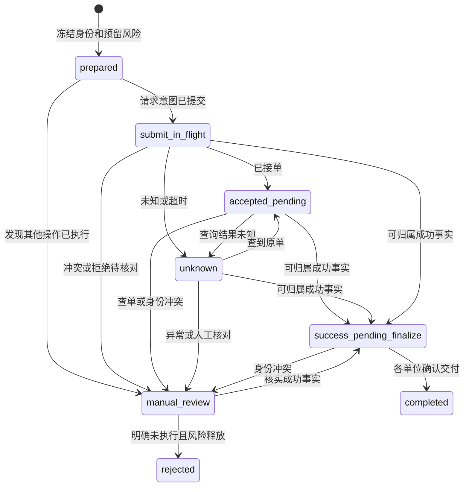

# ⑥-4B-2：隔离采购执行内核与风险预算

## 范围和隔离

本阶段固定基线为 `58f196fbc080eaf1d05173099ba7a77b46018950`，沿用 ⑥-4B-1 的成交来源、采购操作和逐单位身份，也继续使用原订单、支付、退款、库存及履约记录。采购来源选择器仍固定返回空集合；reviewed 映射、预算策略和操作身份均不构成生产采购资格。卡易信只读 API 与数据库禁售约束继续有效，旧 `http_json_v1` 的协议和能力声明不变。

执行内核只接受调用者显式传入的合成传输函数，没有实际供应商 HTTP 适配器、生产采购入口、后台启动开关或采购调度器。合成请求中的本地业务号只是关联本店事实的身份，不是已验证的卡易信 `outerNumber`；传输结果也不是供应商能力证据。本阶段不读取真实商户凭据，不构造正式采购载荷，不访问供应商采购或退款接口，不进行真实采购或部署。

## 操作、请求和证据

采购操作 UUID、来源、已封存的单位集合和本地业务号继续由 ⑥-4B-1 的表提供。`procurement_preparation_requests` 将显式准备幂等 UUID 与操作、订单项、单位、币种和最大金额永久绑定；重放相同准备身份返回原操作，新的准备决定必须显式使用新的身份。新增 `procurement_execution_leases` 记录有界租约、令牌、请求代际及下次动作时间；`procurement_request_intents` 只追加，在事务提交后才进行传输调用，同一个操作最多存在一条 submit 意图。发送前持订单锁重检原付款资格和预算，结果在事务外获取，返回后重新锁定并以操作、代际、动作及本地业务身份归属事实。

正常路径从 `prepared` 进入 `submit_in_flight`，可以观察到 `accepted_pending`、`unknown`、`manual_review` 或 `success_pending_finalize`；完成各单位的原履约后才进入 `completed`。明确拒绝事实可留在人工核对，不能仅靠更改状态释放采购义务。租约过期后原在途操作进入未知状态并查询原身份；超时、5xx、畸形响应和负查单不能触发重新创建请求。即使业务号相同，也不假设供应商去重。已知供应商单号不可替换；同连接范围内的单号冲突按事实保存并阻止重复完成。

图中从在途、待处理或未知进入查询只追加 query 意图，不会再次进入创建请求；最终终态不会回退。存在迟到事实时另追加冲突及预算事实，不重写已确认终态。

`procurement_execution_evidence` 以追加方式记录请求归属、代际、响应摘要、观察类型、供应商单号以及已证实的本地单位集合；合成的 `delivery_confirmed` 与采购成功分开，必须对应相同操作、单位及摘要的成功事实。扣费事实另有显式金额和币种，不能把成功结果当作已确认扣费。`procurement_execution_conflicts` 为同源单号和迟到执行涉及同一单位等冲突保留双方的人工核对事实。过期租约的迟到响应仍能追加可信事实，不能覆盖较新的权威状态或已确认终态。隔离解析器检查冻结的连接版本、凭据版本及密钥身份；不可用时不产生请求意图，也不会发送。响应归属不明及其他不能安全判断的情况保留未知风险，不记录秘密或顾客资料正文。

身份冲突中的供应商号不用于自动查单；存在尚未解决的 `identity_conflict` 事实时，后续领取进入人工核对，前向迁移 `202610270006_procurement_identity_conflict_guard` 也在数据库层阻止发送和最终交付。当前没有绕过或解除该门禁的生产入口。

请求超时后，进程仍在运行时会对迟到响应的证据写入做有界重试；持续数据库错误时只报告不含响应正文的失败，无法保证该内存中的响应已经持久化。此时原意图、未知状态与风险占额保留，恢复仍须按原身份查单或人工核对；进程崩溃多边界恢复属于 ⑥-4B-3，不能由此宣称通过。

## 风险预算和只追加流水

`procurement_risk_policies` 持久化每笔上限、全局/供应商/SKU 各自的每日新增额度和未核销敞口上限以及暂停状态。受控夹具必须显式提供金额、币种和限额；本阶段数据库和服务只允许合成币种代码 `TST`。已经初始化的限额不可由另一次调用提高或覆盖，暂停通过数据库行串行化；这不是生产采购授权或销售配置。

`procurement_risk_reservations` 将最大风险金额、币种及 UTC 日期绑定新建的操作与冻结来源；同一事务还封存单位并建立预留事实。数据库检查操作最初事件与预留出现在同一事务，原有无预算的身份不会被后来自动补绑，发送入口也拒绝无预留的历史身份。重复准备仅能复用同币种、同金额的原预留。账本不读取参考报价、本店售价或成本价，也不推算真实上游数量、手续费和最大扣费。

`procurement_risk_events` 为预留、确认扣费、明确未执行释放以及矛盾事实导致的重新计入保留只追加事实。部分成功和进入人工核对也各自追加零金额事实，分别关联部分成功证据和操作状态历史修订；它们不改变风险余额，重复触发不会重复记账。按币种分别维护的 `procurement_risk_buckets` 和 `procurement_risk_daily` 是由账本触发器维护的汇总，数据库禁止直接修改、删除或截断；单笔、每日毛新增和跨日未核销敞口分别核对。每日毛新增不会因释放减少，未知、待确认扣费或人工核对不会因跨日自动释放。部分成功缺少可靠的分摊金额时继续占额；全额释放需要同操作、同币种、同金额的明确未执行证据，且不能已有成功或扣费证据。确认扣费须有金额和币种一致的 `debit_confirmed` 证据。

如果先前已释放的操作后来出现可信成功或扣费事实，证据入库的同一事务追加一次 `reinstate`，恢复全局、供应商及 SKU 敞口，即使由此超过额度也必须保留真实风险；这不更改原日毛额度。预算事实不可覆盖或删除，同一证据和事实的重放不得重复结算。异常事实、终态及本地单位冲突仍需要人工处理，不能把恢复敞口视为供应商扣费已经核实。

## 订单、履约与锁序

新执行准备沿用订单和订单项锁与原财务资格判断：非零订单、足额确认付款、没有未决支付、开放对账、退款申请、退款预留或已退款事实。采购操作的未完成义务继续纳入原退款保护；外部迟到执行事实不能因本地退款竞争而丢失。发送前与最终交付前分别检查资格，成功采购事实本身不制造交付。

最终交付按 `(operation_id, unit_index)` 一对一关联原 `order_item_fulfillment_attempts` 和 `order_item_fulfillment_deliveries`，仅在夹具明确确认对应单位可交付完成后进入原成功、库存消费和订单完成逻辑；普通采购成功本身留在待最终交付状态。采购义务与其他履约方式之间的冲突由原订单锁与数据库检查保护；同一操作可以有多个本地单位，各单位的证据、完成和未完成状态分别保存。旧操作拒绝后若出现迟到执行事实，退款、同单位新采购和原人工履约均需重新阻断并保留核对事实。

跨事务锁序为订单 → 订单项 → 必要时商品、SKU、数量库存及履约配置 → 预算策略与按全局、供应商、SKU 顺序的预算桶 → 供应商单号 advisory 锁 → 采购操作、单位与原履约记录。新建操作在首次事务提交前不可见；网络调用在事务外。预算事件、暂停、请求意图、证据及最终履约均须遵守相同顺序；数据库直接写入遇到不能安全等待的预算锁应拒绝，不能反向等待。原支付与退款路径仍以订单锁串行化，预算管理不能反向获取订单或商品锁。

## 验证及后续边界

预算专项使用独立 PostgreSQL 数据库验证跨日风险、日毛额度、明确证据结算、相互冲突的迟到事实恢复敞口、暂停、只追加约束与计数器直接 SQL 防护；两个数据库连接以真实事务锁和 `pg_blocking_pids` 验证并发超限。隔离执行器及原交易回归使用真实 PostgreSQL、Fastify 和受控合成夹具；其具体运行结果、全量 `pnpm verify`、跳过或 flaky 项及最终提交对应 GitHub Actions 以本阶段交付记录为准。

2026-10-27 在独立 `_test` PostgreSQL 和临时目录运行完整 `pnpm verify` 成功：金额单测 16/16，API 27 个文件、452/452，浏览器主套件 93/93，品牌变体 1/1、SSR 错误页 3/3、开发预览 1/1、生产品牌运行时 1/1；没有跳过或 flaky。隔离执行器 31 项、预算专项 7 项及历史冲突迁移专项 1 项包含在 API 全量内，不重复累加。lint 有 7 条原有 Vue 格式警告，无错误。Google Fonts 和 Icons 元数据请求超时，构建及浏览器服务使用本地回退并完成。初轮 API 全量的 5 项旧迁移测试因新的前向不可回退保护失败，已改用隔离历史 schema 保留原升级／回退断言；此后身份冲突补强也重新执行完整验证，结果如上。最终提交对应的 GitHub Actions 以交付记录中实际结果为准。

⑥-4B-3 仍需覆盖真实进程 SIGKILL 的多边界恢复，并在获得可靠协议证据前维持生产阻断。**NOT_VERIFIED：**真实商户认证与采购、数量换算、`safePrice`、`outerNumber` 去重、实际扣费、查单一致性、图片协议、新购买资料归档真实 SIGKILL 以及在线生产数据库和私有卷一致性备份。合成传输、数据库事务或本地业务号不构成上述真实供应商行为的验收。

## ⑥-4B-2 精准 R1：跨操作供应商单号冲突

固定基线 `53d03e942a20832799867bbca96b003c0323f9cc` 的 Actions `40507798837` 成功。先在独立 PostgreSQL 和回环 HTTP 夹具中构造两个付款订单、同连接及相同单号；三个新增断言在原提交全部失败。A 已接单时，夹具实际收到 `submit(A), submit(B), query(A, S)`，双方有冲突事实但 A 的自动查单仍发出；A 已完成时，碰撞后的 `order_has_unresolved_fulfillment` 仍为 false；A 明确拒绝并释放 10 TST 后，碰撞后的敞口仍为 0 且退款门禁仍为 false。A/B 原始证据及双方冲突事实均已保存，根因是领取、退款、风险恢复等路径分别只看本操作 `identity_conflict` 或终态，没有统一消费跨操作的 `supplier_number` 冲突事实。

前向迁移 `202610270007_procurement_global_conflicts` 新增统一的 `procurement_has_unresolved_conflict` 判断，涵盖本操作身份异常、同操作不同单号、同连接跨操作同号、已存在的不可变冲突及同单位历史执行风险。执行器和数据库请求意图、状态转换、原履约及退款门禁复用该判断；争议单号不会用于新的自动查询，冲突事实仍可被追加。已确认的 `completed` 或 `rejected` 终态与历史交付不回退，后续退款和竞争交付按未解决风险阻断。

跨操作碰撞事实生成时，在同一事务引用该事实追加一次原操作的 `reinstate`，不伪造扣费或交付，不扣减每日毛新增额度；真实敞口可超过预算上限。全局、供应商与 SKU 桶仍由原流水触发器维护。对于升级前已经发生且未恢复风险的历史碰撞，迁移拒绝升级并回滚，不静默修改已有业务事实。无冲突的不同连接相同单号、同操作连续查单及原履约继续按原规则处理。

锁序仍为订单 → 订单项 → 预算策略 → 供应商单号 advisory 锁 → 操作与单位。冲突事实及对方敞口恢复不反向获取对方订单锁；退款和原履约在各自订单锁下与预算策略串行，再以新的事务快照复核。直接 SQL 从已锁行进入可能反序的路径使用 `NOWAIT` 或非阻塞 advisory 锁，不能通过等待制造锁环。受控门闩测试用 `pg_blocking_pids` 验证跨订单碰撞与退款、人工交付和替代采购竞争；并以历史日期和预算填充验证跨日、超限恢复及重复事实的幂等。夹具结果仅证明本地行为，上述真实供应商和生产恢复的 NOT_VERIFIED 边界不变。

2026-10-27 本地完整 `pnpm verify` 通过：金额单测 16/16、真实 PostgreSQL API 27 个文件 457/457，浏览器主套件 93/93，品牌变体 1/1、SSR 3/3、开发预览 1/1、生产品牌运行时 1/1；无跳过或 flaky。lint 为 7 条既有 Vue 格式警告、无错误；Google Fonts／Icons 元数据超时后使用本地回退。最初的三项 R1 断言在固定基线上全部失败，修复后通过；新增负载测试曾触发测试 Fastify 实例的限流，扩大隔离测试实例后完整回归通过，这不是生产限流规则变更。最终 SHA 的 GitHub Actions 及 Compose 跳过项以交付记录的实际结果为准。
