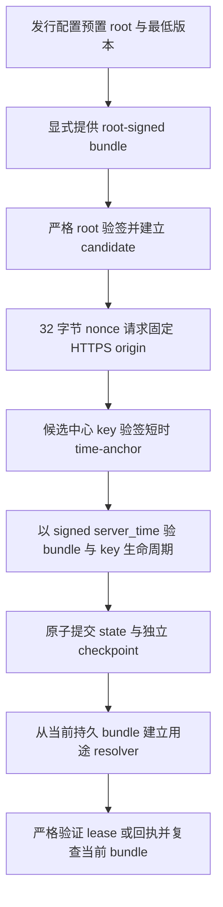

# ⑦-1B-3B 商城可信签名、Trust Bundle 与时间引导

本阶段在商城 API 内集成受发行信任配置约束的 Ed25519 验证内核、Trust Bundle 单调存储、HTTPS time-anchor 客户端和严格用途验证器。授权中心仓库只读，基线为 `6f554b51b867a15ad7747c6d002b548e016f65c6`；商城冻结基线为 `ce01affdc69771537e219ddf8746cb8c24f27001`。

3B **不构成商城经营门禁**。不改现有订单、充值或其他业务，不增数据库授权权威、不提供激活操作或续签 worker，也不实现3D经营状态投影。

## 发行信任配置

`TrustedReleaseLicenseConfig` 是唯一的验证根边界，要求精确 HTTPS issuer/origin、离线 Ed25519 根公钥 JWK、其 RFC 7638 JKT、最低 bundle 版本、配置 schema 版本、配置身份、发行 ID 和发行清单摘要。验证器拒绝未知字段、路径型 issuer、issuer/origin 不同、公私钥字段混入、非规范 JWK 和错误 JKT。

`trusted-release-license-config.generated.ts` 是发行管线的插入点，目前内容为 `null`。本轮没有正式生产 root 或签名发行清单，不能据此建立生产信任。配置缺失时能力状态为 `trust_uninitialized`；已配置但尚无显式导入的 bundle 时为 `bundle_not_initialized`。代码不从 JWT、time-anchor、普通环境变量或网络响应学习 root，也没有 `LICENSE_ENABLED=false` 放行路径。将来只能由验证过签名发行清单的发行流程生成并随发行工件提供此配置。

开发/互操作测试使用每次测试临时生成的密钥和独立 HTTPS 服务器。固定的跨仓互操作 fixture 只含授权中心冻结源码生成的公开 JWK 与真实签名样本，不含私钥，不用于生产默认值。

## 客户端内核来源与适配

本轮以只读授权中心提交 `6f554b51b867a15ad7747c6d002b548e016f65c6` 中已经验收的客户端验证实现为来源，未复制或引入中心管理员、服务端业务、签发工具或任何私钥：

- `src/trust/trust-bundle.ts`、`src/strict-json.ts`：复用严格 bundle schema、root pin、重复字段拒绝、canonical Base64URL、JWK/JKT、Ed25519 和 claim allowlist。商城版本删除了仅供离线签发预览/输入校验使用的导出接口。
- `src/trust/trust-bundle-store.ts`：复用版本单调、密钥生命周期、撤销/退休墓碑、双文件 checkpoint、原子写入与恢复状态机。商城适配加入受控可信时间源、锁内时间重查、API 用户目录归属检查、锁持有后孤儿临时文件清理和仅供 time-anchor 使用的 pending candidate 读取。candidate 没有可直接构造经营 resolver 的公开辅助函数。
- `src/crypto/jwt.ts`：复用严格 Ed25519 compact JWS 验签和用途 resolver 约束；商城保留验证子集，不带签名能力。
- `src/crypto/time-reset.ts`、`src/receipts.ts` 与客户端交接文档：作为 3B 协议边界的只读参考。time-reset 应用、迁移/灾难重绑回执和状态投影没有集成。

商城发行和 CI 只需要本仓已锁定的 `jose`、`jsonc-parser` 依赖及本地源文件，不会在运行时引用授权中心 checkout、绝对开发机路径、GitHub 或私有 npm 在线服务。跨仓互操作 fixture 的 `source_commit` 精确记录上述中心提交；回归用其真实 root-signed bundle、time-anchor、lease、challenge、status 和 operation JWS 验证商城实现。

## Trust Bundle 接受与持久状态

只有离线 root 预置公钥验证成功，才产生进程内的 `RootAuthenticatedTrustBundleCandidate`。候选仅能选择其中一个中心 key 来验签 time-anchor，不能用于经营 JWT。time-anchor 通过 nonce、中心 key、签名时间窗、key 生命周期和 bundle 时间窗验证之后，TrustBundleStore 才接受其为当前 bundle。

本阶段没有常驻 bundle 下载服务，也没有授权中心 bundle 下载 API。受信根签名的工件只能由内部调用者显式提供给 `importProvidedBundle()`；不存在自动发现、首次联网信任、环境变量 root 回退或生产默认样本。时间 anchor 本身不表示已导入或已接受 bundle。

持久文件位于 `LICENSE_TRUST_STORE_ROOT`，默认 `$XDG_DATA_HOME/aikayun/license-trust`。启动配置要求它在仓库之外，并与 `MEDIA_ROOT`、`PRIVATE_FILE_ROOT` 和 3A `INSTANCE_IDENTITY_ROOT` 不重叠。Compose 使用 API 专属 `license_trust_store` 命名卷和一次性 root 初始化容器；API 以非 root 用户访问。状态中保存 root 可验证的原 compact token、artifact digest、bundle version 及排序后的永久墓碑；独立 checkpoint 记录 issuer、root JKT、发行最低版本、已提交头和可恢复的 pending 头。

每个文件通过同目录临时文件、文件 `fsync`、原子 rename、目录 `fsync` 写入。checkpoint 先记录 pending，再写主状态，最后将 checkpoint 提交到新头。恢复时只有状态与 pending 两侧精确匹配的情况才能完成或放弃；分叉、缺少独立 checkpoint、损坏、错 root、混合代次或低于发行最低版本均 fail closed。卷初次为空时只报告 `bundle_not_initialized`，不会自动重放任何工件。卷丢失后需要显式人工重新提供工件；持久 checkpoint 丢失时不能声称记得卷内最后接受的版本，重新初始化仍受发行最低版本约束。若同一高权限操作者同时回滚中心数据库和全部客户持久介质，双文件 checkpoint 本身不能独立识别该全局回滚，属于生产恢复门禁。

版本只能递增；相同版本仅允许同一签名工件幂等接受。最低版本来自发行配置。活动 key 不能静默删除；正常退休的 key 在 `verify_until` 排除边界之前保留验证能力，生命周期要求 `not_before <= iat`，且设置 `retire_after` 后要求 `iat < retire_after`；同时为最多 7 天 lease 与签名 propagation budget 保留窗口。紧急撤销立即禁止该 key 作当前证据。`revoked_kids` 与 `retired_kids` 分别永久保留，容量耗尽会拒绝接受新 bundle，不会丢弃墓碑。

## HTTPS 时间引导与 TLS 边界

客户端只向发行配置中的准确 `https://<origin>/v1/time-anchor` 发送一个 32 字节密码学随机 nonce。响应限 4 KiB，要求 JSON 精确只有 `time_anchor` 字段；重定向、非 200、非 JSON、重复字段、错误 nonce、重放、错误 kid 和超限响应拒绝。TLS 使用 Node 24 标准证书/hostname 校验，`rejectUnauthorized` 保持开启，无通用 CA 信任或重定向跟随。

时间样本用 `performance.now()` 计算往返，超过 5000ms 拒绝；time-anchor 必须是独立 `typ=aikayun-time-anchor+jwt`、`aud=aikayun-time-bootstrap`、准确中心 `iss`、绑定本次 nonce、`iat=nbf=server_time`、`exp=server_time+30` 的严格 Ed25519 JWT。接受 bundle 前，用这个签名 `server_time` 验 candidate 窗口和 key 生命周期。样本最多沿单调时钟外推，超过 30 秒或签名过期即拒绝；等待文件锁和处理时间也会执行 freshness 检查。

受控测试将 JavaScript wall clock 分别偏移到签名时间前后五年，验证仍以签名中心时间为准，没有修改系统时钟。**TLS 建连仍依赖系统时钟验证证书有效期**；若真实机器偏差大到使 TLS 证书校验失败，time-anchor 尚未建立，真实启动场景为 `NOT_VERIFIED`。禁止关闭 TLS 校验来绕过此限制，应先修复主机时间或证书链。

## 类型化 JWT 与未来交接

当前经营 lease 验证要求已接受 bundle resolver、`aikayun-license+jwt`/`aikayun-commerce`、精确 claims、Ed25519、非过期时间、3A ready identity、固定 instance/database/JKT。还要求 `exp=min(iat+604800,subscription_end)`、`renew_after=min(iat+21600,exp)`、`nbf=iat`、规范正十进制 generation/revision 和有序 grants `create_order,create_top_up`。结果是 `VerifiedCurrentLeaseEvidence`，包含签名 key ID，**不返回 `canCreateOrder` 或 `canCreateTopUp`**。调用方仍须后续阶段的持久化状态与最终门禁决策。

历史已过期 lease 使用单独的 `VerifiedHistoricalLeaseEvidence` 接口与 purpose 标签；不能作为当前经营证据。它仍要求当前留存且未吊销的 key。正常退休 key 超过 `verify_until` 并被当前 bundle 移除后，不能假设任意多年以前的原始 JWS 还能验证；后续 3C 应用新鲜、受信的 operation 回执与本地持久 attempt 摘要证明已提交事实。

Challenge、Status、Operation 分别使用各自的 `typ` 和精确 claims allowlist；audience 按冻结中心 profile 校验（业务回执为 `aikayun-commerce`，time-anchor 使用独立 `aikayun-time-bootstrap`）。用途验证器互不替代；无效签名、未知 kid、撤销 key、身份错配、错误 typ/aud 和过期时间都拒绝。此阶段只提供 Challenge/Status/Operation 的基础验签接口，不接受迁移 ticket、灾难重绑或 time-reset 的业务状态转换。

后续阶段边界：3C 才可实现 challenge/operation 请求、持钥证明和 attempt 摘要持久化，并在恢复时用新鲜 operation 回执关联已提交结果；3D 负责独立的经营状态投影；3E 才处理 time-reset、迁移/灾难重绑及相关状态绑定；3F 再按最终验收接入新订单/充值门禁，同时保护既有付款、退款、交付、提现和历史下载义务。上述功能均不由 3B 启动。

## 配对备份与恢复

Compose 静止窗口备份格式升级为明确的 `aikayun-compose-backup-v4`，归档包含 PostgreSQL、公开媒体、私有交付文件、3A 安装身份和授权 Trust Store，并对每个归档做 SHA-256 校验。隔离恢复脚本只接受 v4、测试数据库和项目专属命名卷；不能用旧 v3 清单悄悄解释新卷。恢复验收同时验证身份 binding、实际 root-signed Trust Bundle 与 checkpoint、私有交付对象及业务快照。

授权状态与数据库保持不同权威边界：信任包及其单调版本只存在于独立 TrustStore；这里不建授权数据库表，也不把 3A identity journal 复用成信任状态。
