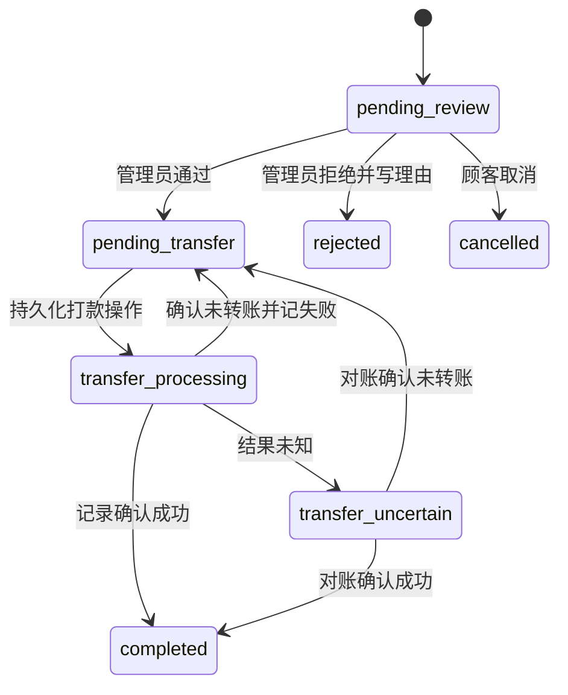

# 顾客提现与人工打款（④-9B）

④-9B在④-1建立的 `withdrawals`、`withdrawal_payout_attempts`、钱包触发器和不可变账本上完成商家审核及人工打款。实现使用前向迁移 `202610210001_withdrawals`，不修改冻结历史迁移、不重建余额，也不增加第二套账本。余额、冻结和扣减仍只由 `wallet_operations` 与 `wallet_ledger_entries` 派生。

## 商家设置与手续费

管理员在 `/admin/withdrawals/settings` 控制提现开关、单次最低/最高金额、固定手续费、百分比手续费和已开放的收款方式。开启提现时至少开放一种方式；可单独启用支付宝、微信或银行卡。设置修改有管理员身份和前后值审计，只影响之后创建的申请。

费用计算由 `packages/money` 的 Decimal.js 完成：

```text
手续费 = round_half_up(提现金额 × 百分比 / 100 + 固定手续费, 2)
预计到账 = 提现金额 - 手续费
```

百分比最多四位小数且不超过100%，金额按统一规则舍入到两位小数。手续费必须小于提现金额，预计到账必须大于零。顾客页面先显示扣除现金金额、手续费及预计到账；提交时 API 重新按当前锁定的设置计算，并把金额、费率结果和收款资料一同写入提现快照。数据库保护这些申请身份和金额，后续商家调价不会改变历史申请。

## 申请、冻结和取消

游客没有提现接口。登录顾客必须在事务中重新验证有效会话并锁定本人顾客与钱包行。只有 `cash_available` 可以申请；赠送现金及所有冻结余额均不参与资格判断。账户已禁用时拒绝新申请，但管理员可以继续处理已存在的提现。

单次申请在一个 PostgreSQL 事务内依次检查身份、锁顾客和钱包、检查幂等键、锁读商家设置、验证方式/限额/余额、计算手续费、绑定私有二维码（如有），再创建提现和唯一钱包操作。插入 `pending_review` 会调用④-1既有触发器，冻结完整提现金额。若任一步失败，申请、冻结、二维码绑定和审计一同回滚；同一顾客同一幂等键及相同请求重放时返回原申请，不重复冻结。数据库钱包行锁及不可为负约束保护多设备竞争。

例如申请100元、手续费2元、预计到账98元：创建时现金可用减少100元、现金冻结增加100元；成功打款时账本只扣冻结100元；拒绝或顾客在待审核期间取消则通过触发器解冻100元。审核通过后顾客不能取消，冻结保持到后续打款处理。审核拒绝必须记录拒绝理由、管理员与时间。

## 收款资料与二维码隐私

支付宝/微信可以提交收款账号、可选收款人姓名和二维码；银行卡必须提交收款人、银行和12～19位卡号。没有支付密码字段。信息快照与提现申请不可分开修改。顾客历史只返回本人资料；后台列表只投影脱敏收款摘要，授权管理员打开单笔详情后才读取执行打款所需的完整资料。顾客不能通过任意 ID 查询其他人的申请或文件。

二维码走同源 multipart 上传接口 `/api/v1/customer/wallet/withdrawal-qr`，最多5 MiB、单文件、无附加字段，只接受可由 Sharp 实际解码且 MIME 匹配的 JPEG、PNG、WebP，单页且不超过8百万像素。图片字节保存在 `withdrawal_private_files` 的私有 `bytea` 字段，没有公开静态 URL。读取仅通过所属顾客接口或已授权管理员的单笔提现接口，响应使用 `private, no-store`、`nosniff` 和 sandbox CSP。未绑定图片24小时后可在后续上传时清理；申请绑定后作为不可变历史保留。上传、文件读取和提交提现的 Fastify 路由静默日志，避免请求体、完整卡号或二维码内容进入应用日志。收款码仅是用户提供的资料，不验证收款身份。

## 状态与人工打款操作



后台将人工打款拆成两个明确步骤：

1. **记录开始打款。** API 在短事务内创建唯一 `withdrawal_payout_attempts`，生成并返回操作 ID，触发器将提现设为 `transfer_processing`。事务提交后管理员才去支付宝、微信或银行实际转账。任何等待外部平台的期间都不持有数据库锁。
2. **记录打款结果。** 成功时录入真实转账参考号、实际金额、实际时间、证据 SHA-256 摘要和核对摘要；到账金额必须等于快照 `payout_amount`。失败只允许在确认未发生转账后登记，操作记录 `confirmed_no_transfer`，资金仍冻结且提现回到 `pending_transfer`，可建立新操作 ID 安全重试。

若浏览器/API 中断或结果未能确定，管理员将原操作标记 `unknown`，提现进入 `transfer_uncertain`，完整金额继续冻结；数据库唯一活动尝试约束阻止第二次启动。只能先核对该操作：确认成功则完成，确认没有转账则以明确失败释放活动尝试并回到待打款。不得通过新尝试绕过未知结果。若外部已成功但 API 响应丢失，管理员应查询原提现和操作 ID 并对原事实幂等重放，不要再次转账。

④-1把 `withdrawal_payout_attempts.provider_reference` 等字段设为身份不可变，而真实转账参考号在操作开始之后才产生。本阶段不伪造预先交易号，也不改写历史尝试：新增不可变 `withdrawal_payout_results`，以 `attempt_id` 一对一关联，在最终结果事务中写入外部参考号、金额、时间和管理员/证据摘要。参考号跨结果表唯一，且新结果触发器也检查历史尝试中已存在的参考号。数据库保证成功结果与提现净到账金额一致、失败必须声明未转账，终态操作和结果不可更新、删除或截断。

## 账本、并发和锁顺序

新增冻结、解冻和完成扣减均调用④-1已有状态与钱包触发器：申请 `pending_review` 冻结现金；拒绝/取消执行 `unfreeze`；完成执行 `debit_frozen`。同一操作、提现和账本关联仍受④-1唯一键及触发器保护。设置审计、状态变化审计、顾客/管理员动作审计、打款尝试和最终结果均只追加。

提现及管理员处理采用统一锁序：

1. 顾客写操作锁顾客并复核会话，然后锁钱包账户，再锁提现；处理打款结果时最后锁对应 payout attempt。
2. 管理员审核、拒绝、取消竞争、开始打款和确认结果按顾客 → 钱包 → 提现 → payout attempt 获取锁。提现创建后顾客禁用不会阻断历史申请审核。
3. 商家设置修改只锁单例设置行。新申请在持有顾客和钱包锁后共享读取设置，得到一致手续费快照。
4. 充值和钱包付款沿用④-8的顾客/订单/钱包顺序，退款入账遵循④-9A顾客/订单/钱包锁序；提现通过相同顾客及钱包行锁与这些动作串行，钱包触发器再验证可用现金。

API 冲突或服务重启不自动判成功/失败；处理中记录能通过管理员列表和单笔详情恢复。活动中的 started/unknown 操作始终阻止重付，未知状态宁可继续冻结。管理员列表按状态支持分页，可查看顾客身份、金额/费用/净到账、脱敏收款摘要；单笔详情包含收款资料、四类钱包余额、该提现的冻结/解冻/扣减账本行、同一顾客历史提现、管理员和顾客审计、每次操作及最终证据。

## 页面与 API

顾客 `/wallet` 提供现金可提现余额、当前手续费说明、金额及方式、收款账号/银行字段、二维码上传、净到账预览、提交确认、服务端状态与历史，以及仅在 `pending_review` 时可用的取消。页面禁用重复提交并刷新后从 API 恢复状态。后台提供 `/admin/withdrawals` 待审核/待打款/处理中/未知/完成/拒绝/取消筛选、`/admin/withdrawals/settings` 设置页和 `/admin/withdrawals/:id` 单笔审核及打款操作页。管理写入继续走现有管理员会话、Origin 与 CSRF 验证。

主要接口：

| 方法与路径 | 用途 | 保护 |
| --- | --- | --- |
| `GET /api/v1/customer/wallet/withdrawals` | 当前顾客余额、公开策略和本人历史 | 顾客会话、本人 ID、`no-store` |
| `POST /api/v1/customer/wallet/withdrawals` | 提交现金提现并冻结全额 | 顾客会话、Origin、双提交 CSRF、限流、幂等键 |
| `POST /api/v1/customer/wallet/withdrawals/:id/cancel` | 取消待审核的本人申请 | 顾客会话、Origin、CSRF、幂等键 |
| `POST /api/v1/customer/wallet/withdrawal-qr` | 上传私有收款二维码 | 顾客会话、Origin、CSRF、文件约束 |
| `GET /api/v1/customer/wallet/withdrawal-qr/:id` | 读取本人私有二维码 | 顾客会话、文件归属、`no-store` |
| `GET/PUT /api/v1/admin/withdrawals/settings` | 读取/修改提现设置 | 管理员会话；PUT 另需 Origin、CSRF |
| `GET /api/v1/admin/withdrawals`、`GET /:id` | 分页状态列表及完整授权详情 | 管理员会话、`no-store` |
| `GET /api/v1/admin/withdrawals/:id/recipient-qr` | 读取单笔申请的二维码 | 管理员会话、提现归属 |
| `POST /api/v1/admin/withdrawals/:id/approve`、`reject` | 审核同意或带理由拒绝 | 管理员会话、Origin、CSRF、幂等键 |
| `POST /api/v1/admin/withdrawals/:id/payout-attempts` | 持久化开始打款操作 | 管理员会话、Origin、CSRF、幂等键 |
| `POST /api/v1/admin/withdrawals/:id/payout-attempts/:attemptId/resolve` | 记成功、确认未转账的失败或未知 | 管理员会话、Origin、CSRF、幂等键 |

金额和账户内容由服务端查询，不从浏览器状态推断资金结果。拒绝、取消、审核、尝试启动、结果核对与设置修改都在对应事务中写审计。

## 验收与未覆盖范围

④-9B集成测试使用真实 PostgreSQL `_test` 数据库验证触发器、事务回滚、金额及手续费边界、幂等、多设备提现、充值/钱包支付/退款竞争、顾客取消和管理员拒绝解冻、并发管理员审核/启动、未知阻断、失败重试、成功仅扣冻结一次、转账参考号唯一、结果不可变、顾客数据隔离、二维码私有访问以及钱包余额与完整账本汇总一致。浏览器 E2E 使用本地支付夹具并显式将打款凭据标记为合成测试数据；它不代表真实外部转账完成。商家真实支付宝/微信/银行打款需要真实凭证人工验收，未完成前状态必须为 `NOT_VERIFIED`。

本阶段不做手续费分账、提现财务报表、自动支付或自动提现，也不部署生产。
